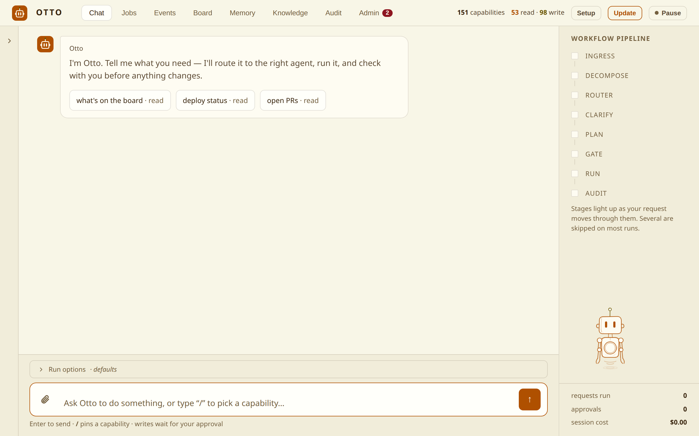
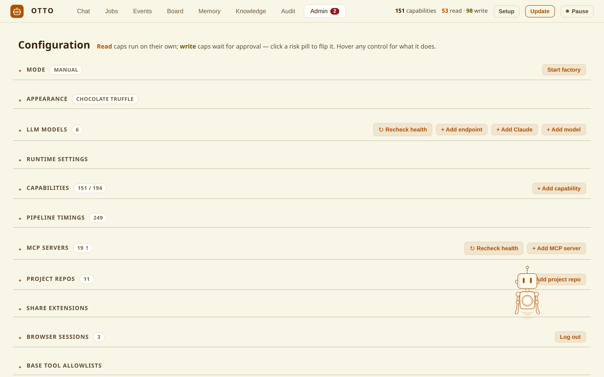
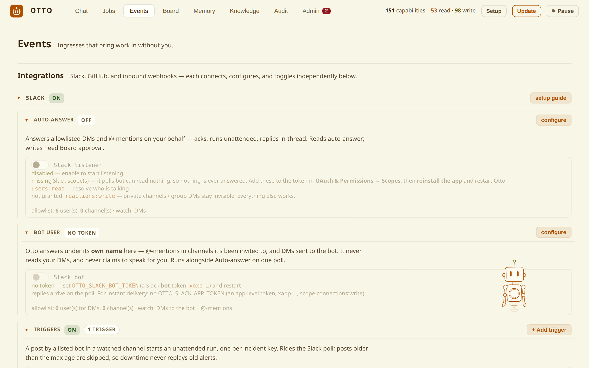
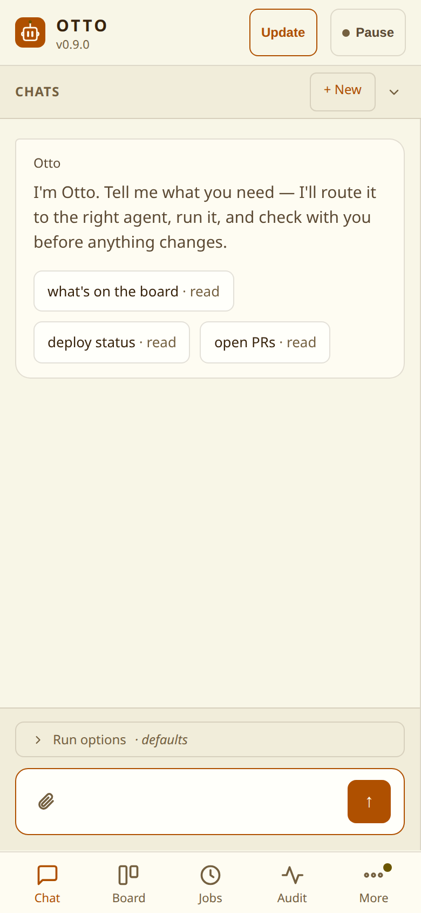

<p align="center">
  
</p>

<h1 align="center">Otto</h1>

<p align="center">
  A local orchestrator for your Claude Code agents — routes, gates, runs, verifies, remembers.
</p>

<p align="center">
  <a href="https://github.com/wonkylabz/otto/actions/workflows/test.yml"></a>
  <a href="https://github.com/wonkylabz/otto/releases"></a>
  
  <a href="LICENSE"></a>
  
</p>

<p align="center">
  
</p>

Otto turns the subagents and skills already in your `~/.claude` into something you can hand
work to from chat, Slack, a cron, a webhook or a GitHub board — and trust the result. Every
request goes through the same pipeline:

```
  you ─▶ INGRESS ─▶ ROUTER ─▶ CLARIFY ─▶ PLAN ─▶ GATE ─▶ RUN ⇄ VERIFY ─▶ AUDIT
         (5 doors)  (pick an   (ask if   (preview  (approve  (judge +   (memory +
                     agent)    unclear)  the work)  writes)   retry×N)   audit log)
```

- **Your agents, not ours.** Discovers `~/.claude/{agents,skills}`, plugins and other repos'
  `.claude/`, and picks the right one per request. `/<name>` pins one.
- **Nothing writes without a plan you approved.** Reads run on their own; writes preview a
  read-only plan and wait for a real approval signal. Expiry declines, never approves.
- **Verified, not just finished.** A judge checks each attempt, feeds the critique back into
  the retry, and escalates the model on the last rung. A stuck or exhausted run lands on the
  **Needs-you** board — nothing fails silently.
- **Durable.** Runs are Temporal workflows: they survive restarts, and approvals and
  clarifications are signals, not polling.
- **Code changes run in an isolated clone**, push a branch, open a draft PR, and get reviewed
  (and optionally QA'd) before you see them.
- **No API key.** Runs on your Claude subscription via `claude -p`. Local OpenAI-compatible
  models and Codex are opt-in backends with Claude as the fallback.

> [!WARNING]
> **Otto runs as you.** It executes an LLM's decisions on your machine with your Claude login,
> your `~/.claude` config and your tools, and its API has one credential with no roles. Keep it
> on `localhost`, don't reverse-proxy it, don't run it on a shared box.
> [SECURITY.md](SECURITY.md) is the threat model — read it first.

## Quick start

You need **Claude Code** (logged in) and **Python 3.12+**. The installer brings the rest —
a venv, the Temporal CLI, `.env`, smoke tests and a background service that runs as you
(systemd `--user` on Linux, launchd on macOS):

```bash
git clone https://github.com/wonkylabz/otto && cd otto
./install.sh            # add --guided to be walked through models, repos, Slack…
./run.sh                # Temporal + worker + web UI on http://localhost:8765
./run.sh login          # prints a single-use login link for your browser
```

Then type a request. Or open Claude Code in the checkout and say *"set up Otto"* — the
bundled `otto-setup` skill configures it through Otto's own API.

<details>
<summary>Manual setup without the installer</summary>

```bash
sudo apt install -y python3-venv                  # Debian/Ubuntu; macOS ships it
# Temporal CLI -> ~/.temporalio/bin (linux_amd64; other platforms: see the release checksums.txt)
curl -sSfL -o temporal.tgz \
  https://github.com/temporalio/cli/releases/download/v1.8.0/temporal_cli_1.8.0_linux_amd64.tar.gz
echo "896c6132d6d969f84c3f2382a31abd9a67a06ed3008c1a37c3573fe81d730e4a  temporal.tgz" \
  | { sha256sum -c 2>/dev/null || shasum -a 256 -c; }
mkdir -p ~/.temporalio/bin && tar -xzf temporal.tgz -C ~/.temporalio/bin temporal
python3 -m venv .venv
./.venv/bin/pip install -r requirements.txt
```

Re-running `./install.sh` is always safe. `python3 doctor.py` reports what is still
unconfigured; `systemd/install.sh` / `launchd/install.sh` (re)install just the service.
</details>

## A look around

<table>
  <tr>
    <td width="50%"><br><sub><b>Admin</b> — capabilities, per-phase models, MCP servers, repos, runtime settings</sub></td>
    <td width="50%"><br><sub><b>Events</b> — Slack (your account and/or a bot), GitHub PR reviews, webhooks, triggers</sub></td>
  </tr>
</table>

<p align="center">
  
  <br><sub>Works on a phone over a private tunnel — see <a href="docs/guide.md#from-your-phone">the guide</a>.</sub>
</p>

| Tab | What it is |
|---|---|
| **Chat** | the front door, and the Needs-you board for anything parked |
| **Jobs** | runbooks — a saved request on a cron or on demand, optionally posted to Slack |
| **Events** | the unattended ingresses: webhooks, Slack, GitHub PR reviews |
| **Board** | live and recent runs with stage, model and cost |
| **Memory** / **Knowledge** | facts Otto learned from past runs; documents you add for retrieval |
| **Audit** | immutable record of every action, including declined writes |
| **Admin** | capabilities, backends, models, MCP, repos, settings, factory mode |

## Five ways in

| Ingress | |
|---|---|
| **Web chat** | the only interactive one — clarifies, waits for your approval |
| **Jobs** | Temporal Schedules; a runbook's prose *is* its approved plan |
| **Webhooks** | `POST /api/events/<cap>`, HMAC-signed over body and timestamp, replay-protected |
| **GitHub board** | Projects v2 as a queue — moving a card to **Ready** is the approval |
| **Slack** | DMs and @-mentions, as you, as a bot user, or both ([docs/slack.md](docs/slack.md)) |

All five normalize into the same workflow with the same gates, verification and audit.

## Backends

| | Runs | Auth | MCP |
|---|---|---|---|
| **Claude** (default) | `claude -p` | your subscription | yes, incl. claude.ai connectors |
| **Local** | OpenAI-style tool loop | your endpoint's key | stdio servers, ranked and capped |
| **Codex** | `codex exec` under `bwrap` | `codex login` or an endpoint | none |

Routing, clarification, planning, judging and memory GC each have their **own** model tier —
a cheap local model can do the plumbing while execution stays on Claude. A local or Codex
model that can't serve a run falls back to Claude unless you make that illegal
(`OTTO_LOCAL_FALLBACK=0`).

## Safety, in one list

- Writes preview a plan and require explicit approval; scheduled writes are skipped unless the
  job opts in.
- Path deny rules, independent of the gate: Otto's state, your credential stores and every
  registered checkout are denied — through Bash too.
- A global **Pause** stops every ingress starting new work; it never kills what's running.
- Per-run cost budgets downshift the model, then stop and ask a human.
- Everything leaving the box (Slack, ntfy, GitHub, webhooks) is scrubbed of credential-shaped
  strings. The audit log is immutable.
- Secrets resolve through one helper command (`OTTO_SECRET_COMMAND`) so they can live in your
  password manager, never in the UI.

## Going further

- [docs/guide.md](docs/guide.md) — working on repos, factory mode, phone access, configuration
  and secrets, the gotchas.
- [docs/operating.md](docs/operating.md) — the service, restart discipline, updating.
- [docs/slack.md](docs/slack.md) — both Slack identities, scope by scope.
- [docs/testing.md](docs/testing.md) — the suite, the regression corpus, guard tests.
- [SECURITY.md](SECURITY.md) — the threat model.
- `CLAUDE.md` + `.claude/rules/` — the maintainer's guide, one file per layer.

## Contributing

```bash
./.venv/bin/python -m unittest -v      # never bare python3 — the Temporal tests self-skip
```

See [CONTRIBUTING.md](CONTRIBUTING.md) for the setup, the regression corpus and the two
ratchets that will fail your first PR if nobody warns you.

## License

[MIT](LICENSE).
